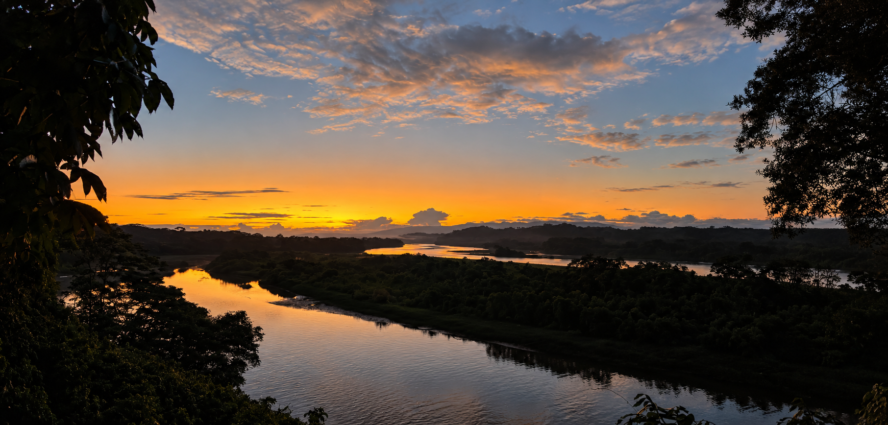

<h1 align="center">Joao Calle Espinoza</h1>

<strong>CONSULTOR</strong>

<strong>HYDROLOGY &nbsp; / &nbsp; GEOMATICS &nbsp; / &nbsp; ENVIRONMENTAL DATA SCIENCE</strong>

<a href="https://jaceconsultingec.com/">JACE Consulting</a> · <a href="https://www.linkedin.com/in/joao-calle-espinoza-347502152/">LinkedIn</a> · <a href="CATALOGO.md">Project catalogue</a> · <a href="README.md">Español</a>

---

### From data to territory.

I am **Joao Calle Espinoza**, a Water Sciences Engineer working across hydrology, programming and geomatics. I combine environmental data analysis, catchment modelling and field observations to study water, soil and land.

At **[JACE Consulting](https://jaceconsultingec.com/)**, I contribute as **Operations and Projects Coordinator**, connecting technical planning, field activities, teams and deliverables.

### Selected work

| WATER & SOIL | DATA & OBSERVATIONS | URBAN DRAINAGE |
| --- | --- | --- |
| **Daule basin erosion** | **Barcelona–Valdivia** | **Nature-based solutions in Durán** |
| RUSLE–SDR, GIS and field/UAV comparisons. | Station time series, quality control and Shiny exploration. | SWMM drainage scenarios and LID alternatives. |
| [Explore →](proyectos/01-daule-rusle-sdr.md#english) | [Explore →](proyectos/03-barcelona-calidad-datos.md#english) | [Explore →](proyectos/07-swmm-duran.md#english) |

### Tools you can explore

- [Daule geospatial explorer](https://jaceconsultingec.com/geovisor/) — erosion factors and management scenarios.
- [Weather bulletins](https://jaceconsultingec.com/boletines.html) — rainfall and temperature for mainland Ecuador.
- [Tena historical archive](https://jaceconsultingec.com/geovisor/tena/) — precipitation exploration.
- [Tena Machine Learning research](proyectos/05-tena-machine-learning.md#english) — Random Forest and validation review.

### Toolkit

**Analysis:** R, Python, GIS, DEMs and time-series quality control.  
**Modelling:** RUSLE, InVEST SDR, EPA SWMM, Random Forest and sensitivity analysis.  
**Communication:** Shiny, Plotly, JavaScript, H3, maps and reproducible documentation.  
**Field integration:** UAV, GNSS RTK and environmental observations.

### Working approach

**Question → data → quality control → model → validation → communication.**

I value interpretability, physical consistency and traceability. Project notes distinguish observations, model estimates and exploratory scenarios and explain limitations and pending validation.

**[Explore all 11 projects and work areas →](CATALOGO.md)**

### Connect

[LinkedIn](https://www.linkedin.com/in/joao-calle-espinoza-347502152/) · [JACE Consulting](https://jaceconsultingec.com/) · [Institutional contact](https://jaceconsultingec.com/contacto.html)

---

Personal portfolio. Academic and collaborative projects retain their coauthorship and affiliations. This profile contains documentation and links; code and data availability are described per project. <a href="docs/ATRIBUCIONES.md">Attribution</a>.
