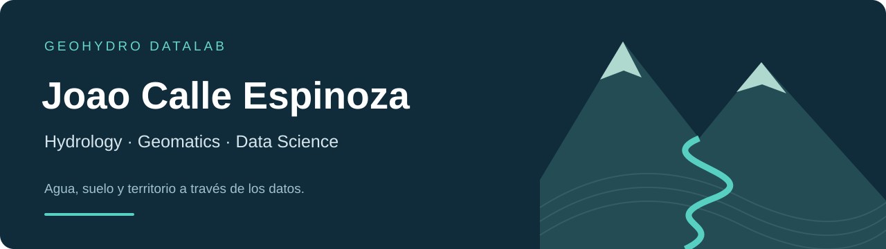

<strong>HYDROLOGY &nbsp; / &nbsp; GEOMATICS &nbsp; / &nbsp; ENVIRONMENTAL DATA SCIENCE</strong>

<a href="https://jaceconsultingec.com/">JACE Consulting</a> · <a href="https://www.linkedin.com/in/joao-calle-espinoza-347502152/">LinkedIn</a> · <a href="CATALOGO.md">Project catalogue</a> · <a href="README.en.md">English</a>

---

### Del dato al territorio.

Soy **Joao Calle Espinoza**, ingeniero en Ciencias del Agua. Integro hidrología, programación y geomática para estudiar cuencas, erosión, lluvia y procesos ambientales. Mi trabajo combina análisis de datos, modelación y observación de campo con herramientas que permiten explorar y comunicar resultados.

En **[JACE Consulting](https://jaceconsultingec.com/)** participo como **Coordinador de Operaciones y Proyectos**, conectando planificación técnica, actividades de campo, equipos y entregables.

### Proyectos destacados

| 01 / AGUA Y SUELO | 02 / DATOS Y OBSERVACIONES | 03 / DRENAJE URBANO |
| --- | --- | --- |
| **Erosión en la cuenca del Daule** | **Barcelona–Valdivia** | **Soluciones basadas en la naturaleza** |
| RUSLE–SDR, análisis espacial y contraste campo–UAV. | Series de estación, calidad de datos y exploración con Shiny. | Comparación de escenarios de drenaje y alternativas LID en Durán. |
| `R` · `Python` · `SIG` | `R` · `data.table` · `Shiny` | `EPA SWMM` · `Sensibilidad` |
| [Explorar proyecto →](proyectos/01-daule-rusle-sdr.md) | [Ver flujo de datos →](proyectos/03-barcelona-calidad-datos.md) | [Conocer el estudio →](proyectos/07-swmm-duran.md) |

### Explora las herramientas

- **[Geovisor Daule](https://jaceconsultingec.com/geovisor/)** — factores de erosión y escenarios de manejo en cartografía H3.
- **[Boletines meteorológicos](https://jaceconsultingec.com/boletines.html)** — lluvia y temperatura para Ecuador continental.
- **[Archivo histórico Tena](https://jaceconsultingec.com/geovisor/tena/)** — consulta espacial y temporal de precipitación.
- **[Investigación ML en el Tena](proyectos/05-tena-machine-learning.md)** — Random Forest y revisión de validación temporal.

### Mi caja de herramientas

| Analizar | Modelar | Comunicar |
| --- | --- | --- |
| R · Python · series temporales | RUSLE · InVEST SDR · EPA SWMM | Shiny · Plotly · JavaScript |
| SIG · DEM · control de calidad | Random Forest · sensibilidad | H3 · mapas · documentación |
| UAV · GNSS RTK · campo | Preparación para regresión simbólica | Flujos reproducibles |

### Cómo abordo un proyecto

**Pregunta → datos → control de calidad → modelo → validación → comunicación.**

Me interesan los modelos interpretables, la coherencia física y la trazabilidad. Cada ficha distingue las observaciones, estimaciones y escenarios; documenta sus límites y el trabajo que falta por validar.

**[Ver los 11 proyectos y líneas de trabajo →](CATALOGO.md)**

### Conversemos

Investigación aplicada, hidrología, erosión, SIG y ciencia de datos ambientales.

**[LinkedIn](https://www.linkedin.com/in/joao-calle-espinoza-347502152/)** · **[JACE Consulting — sitio oficial](https://jaceconsultingec.com/)** · **[Contacto institucional](https://jaceconsultingec.com/contacto.html)**

---

Portafolio personal. Los trabajos académicos y colaborativos conservan sus coautorías y afiliaciones. Este perfil reúne documentación y enlaces; la disponibilidad de código y datos se indica por proyecto. <a href="docs/ATRIBUCIONES.md">Atribuciones</a>.
